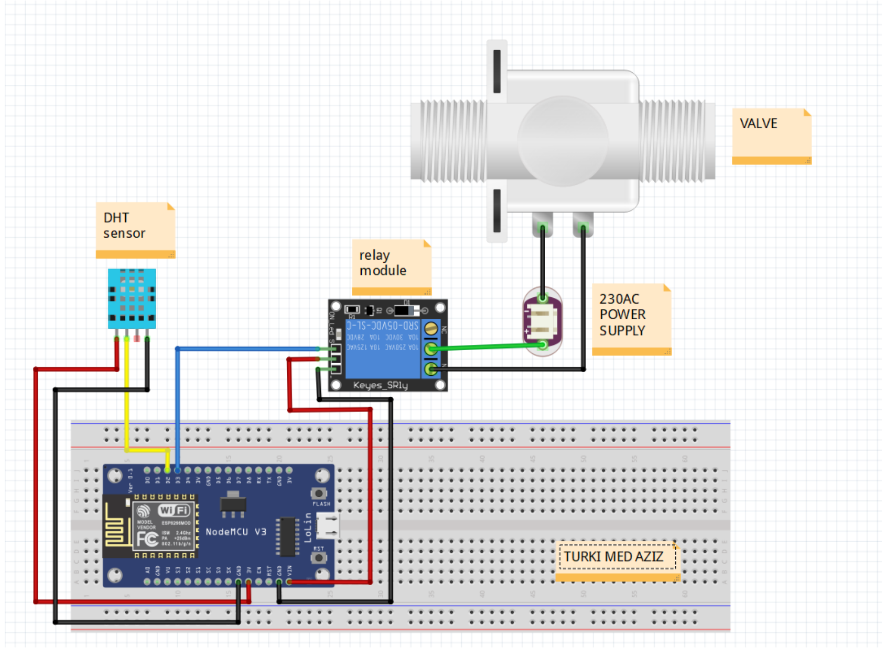
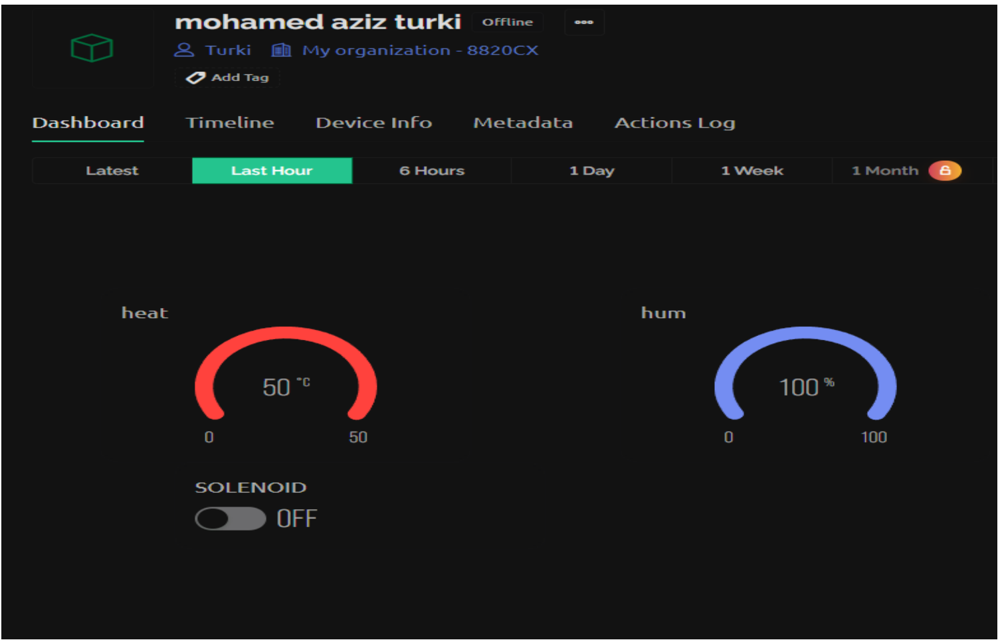

# Smart Valve Control

An embedded systems internship prototype for monitoring temperature and humidity around an LPG station and controlling a solenoid valve. This repository documents the project described in Mohamed Aziz Turki's 2023 internship report at FUBA Printed Circuits.

## Project overview

The report describes a NodeMCU ESP8266 reading a DHT11 temperature and humidity sensor. A temperature condition triggers a relay connected to a solenoid valve; the report says the valve remains on until the temperature falls. A Blynk dashboard displays temperature and humidity and provides a manual valve toggle. Measurements are sent to Google Sheets every five minutes with date and time.

The report does not state the automatic temperature threshold. This repository does not claim a particular threshold, validated performance, or production deployment.

## Hardware and software documented in the report

- NodeMCU ESP8266
- DHT11 temperature and humidity sensor
- Relay module and solenoid valve
- Arduino IDE, Blynk, and Google Sheets

## Project materials

- [Original internship report](report.pdf)

### Circuit diagram

### Blynk dashboard

The circuit image is reproduced from the report's schematic page. The report includes a 230 VAC power supply and describes an LPG facility. Treat these materials as a historical project record, not wiring or deployment instructions. Do not connect this student prototype to an industrial gas installation or mains power. Any physical implementation requires review by qualified electrical and safety professionals.

## Source status

The original firmware source files are not available. The report includes selected code excerpts and screenshots, but not a complete source archive. No reconstructed or production-ready firmware is presented here.

© reserved to MAT
